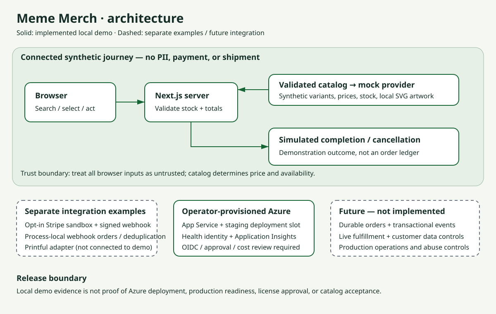
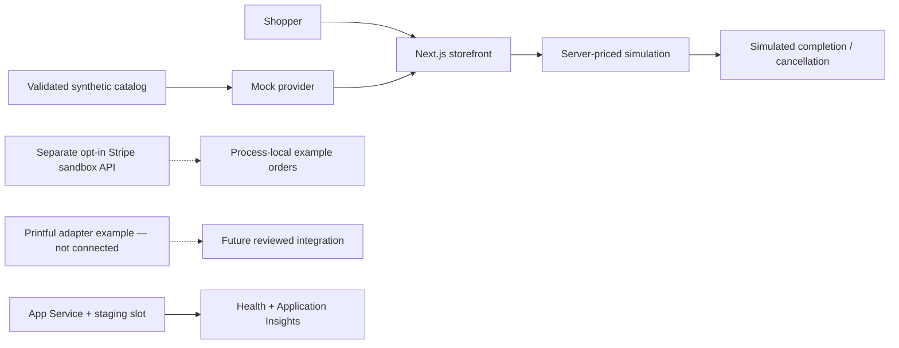

```text
             .-""""-.       .-""""-.
            /        \_____/        \
           /    ___           ___    \
          /____/   |  MEME   |   \____\
                   |  MERCH  |
                   |  :-)    |
                   |         |
                   |_________|

          DISCOVER  •  ADAPT  •  DEPLOY
```

# Meme Merch: Azure Storefront Accelerator

**Explore a merchandise storefront on Azure, adapt its integration patterns, and scope your next commerce pilot.**

> **Readiness: local demo candidate, not catalog-approved or production-ready.**
> The default journey is an explicitly labeled simulation: no money, customer
> details, shipments, or external providers. Licensing, catalog schema verification,
> independent presenter rehearsal, and Azure validation remain release gates.

## Customer story

Retail and brand teams need a practical way to test merchandise ideas without
committing to a full commerce-platform implementation. Disconnected catalogs,
payment integrations, fulfillment providers, and deployment processes make even
a small pilot difficult to coordinate. This build connects synthetic product
discovery to a simulated purchase outcome and provides integration patterns for
Azure. It helps commerce product owners, developers, and platform engineers agree
on a bounded pilot and identify the controls required before accepting real orders.

**Target:** reusable across retail, consumer goods, and merchandise programs.
**Not:** a complete commerce platform, AI shopping assistant, or production service.

## Start locally

Use **Node.js 22** and **npm**. In your checkout (the task environment uses
`/home/runner/work/meme-t-shirt-eshop/meme-t-shirt-eshop`):

```sh
npm ci
npm run dev
```

Open <http://localhost:3000>. No Stripe, Printful, Azure subscription, or credentials
are needed for the core demo. See [setup and customization](docs/setup.md) for the
configuration contract, reset procedure, and optional sandbox API boundaries.

For a production-mode local rehearsal:

```sh
npm run build
npm run start
```

## What you can demonstrate

- Search and category-filter a validated synthetic catalog.
- Inspect original local artwork, variants, prices, and stock.
- Review a variant and quantity using server-authoritative prices.
- Complete or cancel an explicitly simulated checkout and inspect its outcome.
- Discuss separate Stripe sandbox API, Printful adapter, and Azure deployment patterns.

The simulation does **not** prove that a payment occurred or a shipment was created.
It is not a durable order ledger. The integration examples are separate from the
credential-free journey.

## End-to-end journey

1. **Request:** select one merchandise campaign, audience, and business hypothesis.
2. **Context:** adapt the synthetic catalog, prices, variants, and stock.
3. **Discover:** search/filter products and inspect a relevant variant.
4. **Review:** choose a quantity and review catalog-derived pricing and availability.
5. **Act:** explicitly complete or cancel the simulated purchase.
6. **Outcome:** inspect the labeled simulated result; no payment or fulfillment occurs.
7. **Next action:** use the evidence to agree on a customer-owned pilot and production backlog.

Follow the [five- and fifteen-minute demo scripts](docs/demo.md); use the
[screenshots and evidence pack](docs/assets/README.md) as a fallback. Do not
present screenshots or local checks as proof of an Azure deployment.

## Architecture





See [architecture and trust boundaries](docs/architecture.md). Future durable
orders, fulfillment orchestration, and customer data handling require explicit
design and review; they are not implied by the demo.

## Customize and reuse

- Update the validated catalog at
  `/home/runner/work/meme-t-shirt-eshop/meme-t-shirt-eshop/lib/catalog/content/catalog.config.json`
  and supply original or appropriately licensed imagery.
- Keep provider credentials server-side and outside source control.
- Define authoritative stock, currency, tax, shipping, and cancellation rules
  before connecting a real provider.
- Adapt the [discovery and pilot materials](docs/readiness.md) to the account.
- Preserve generated Squad source/lock pairs and integrity checks; do not edit
  generated workflows as independent templates.

Review [catalog operator guidance](lib/catalog/content/README.md) and the
provider contract tests before adapting integrations. Prices in the demo are
illustrative merchandise totals, not tax or delivery quotations.

## Validate changes

```sh
npm run lint
npm run typecheck
npm test
npm run build
npm run test:deployment
```

CI runs application checks and workflow/protected-path integrity gates. A
configured workflow is not evidence that a given release passed: record the
commit, commands, results, and remaining gaps in the
[evidence pack](docs/assets/README.md).

## Deploy to Azure

Follow the [operator deployment guide](infra/README.md). The reviewed Bicep
scaffold provisions App Service, a staging slot, Application Insights, and Log
Analytics. Operators own infrastructure, cost approval, OIDC identity, repository
variables, and GitHub environments. Deployment defaults to disabled until configured.

`GET /api/health` returns `status` and `deploymentSha`. Deployment verifies the
expected revision before and after a slot swap and supports rollback. Optional
server telemetry uses `APPLICATIONINSIGHTS_CONNECTION_STRING`; deployment identity
is resolved from `DEPLOYMENT_SHA`, `GITHUB_SHA`, `WEBSITE_SHA`, then `SCM_COMMIT_ID`,
falling back to `unknown`.

## Security, privacy, and limitations

- Use synthetic data only; the core demo asks for no customer PII.
- No real transactions or live fulfillment are supported by this accelerator.
- Stripe webhook example orders and deduplication state are process-local,
  not a durable multi-instance system.
- Review abuse controls, event ordering, persistence, accessibility, privacy,
  and operational ownership before a customer pilot.
- Do not publish customer configuration, secrets, or unsanitized operational captures.

Read [security guidance](SECURITY.md) and [support/known limitations](SUPPORT.md).

## Catalog submission and licensing

[`accelerator.yaml`](accelerator.yaml) is **draft metadata, not a verified catalog
submission format**. The requested catalog is access-controlled; its requirements
must be reviewed by an authorized contributor before submission. See the
[readiness gates and customer engagement kit](docs/readiness.md).

**No license grant is supplied.** A repository owner must approve licensing and
third-party notices before redistribution. Original sample artwork does not
resolve the repository-wide licensing decision.

## Start a customer conversation

“Could we use one merchandise pilot to identify where discovery, payments,
fulfillment, and deployment handoffs create friction?”

Bring a product owner, platform lead, and one campaign example to a discovery
workshop. Leave with an agreed pilot scope, measurable acceptance criteria,
named owners, and a go/no-go decision—not an unqualified production promise.
