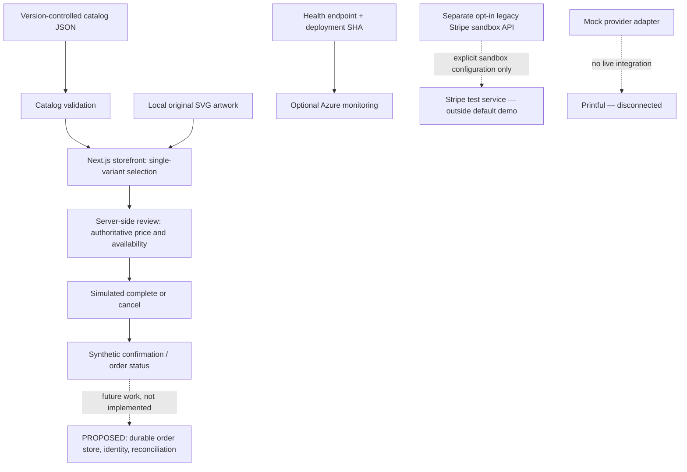

# Architecture and boundaries

## Customer story

A retail innovation team wants to validate a small merchandise experience before
committing to payments, customer data, or fulfillment integration. A facilitator
uses synthetic products to show selection, review, a simulated decision, and an
order-status view. The useful outcome is agreement on a pilot, not an order to
ship. This is a reference demonstration, not a production commerce system.

## Current demonstration

Solid arrows describe the demonstration path. Dashed arrows denote a separate
opt-in sandbox or a disconnected/proposed boundary, not a default transaction.
An [accessible static SVG diagram](assets/architecture.svg) is also available
for presentations and environments without Mermaid rendering.
The simulated path does not call Stripe or Printful and needs no provider
credentials. It collects no real customer, delivery, or payment information.
Confirmation and status are synthetic; do not infer durable orders, reserved
stock, a payment receipt, or a shipment.

## Responsibilities and trust

| Component | Responsibility / limit |
| --- | --- |
| `lib/catalog/content/catalog.config.json` | Editable sample categories, tags, products, variants, prices, availability, and image references. |
| Catalog loader / validator | Rejects invalid structure, duplicate IDs, and broken relationships; no catalog administration service or external inventory synchronization. |
| Browser | Sends a single variant ID and quantity by GET; URL-controlled values are untrusted. There is no persistent cart. |
| Server review / simulation | Resolves selected variant IDs against the validated catalog; determines prices and availability rather than accepting client totals. Completion is simulated. |
| Provider abstraction | Mock implementation supports development; an interface is not a working fulfillment connector. |
| Legacy payment API | Separate from the demo. Requires explicit sandbox enablement and a Stripe test key; resolves authoritative catalog prices. Never configure live credentials for a workshop. |
| Health and telemetry | `/api/health` exposes service health and deployment identity, not business readiness. Optional Application Insights does not prove order completion. |

The demo is not a security boundary for customer records. Do not introduce PII,
live payments, provider webhooks, or production secrets to make a demonstration
look realistic.

### Concrete simulation contract

`/catalog` links to `/catalog/classic-meme-tee` and
`/catalog/limited-drop-hoodie`. The product form sends
`GET /checkout?variantId=classic-meme-tee-s-black&quantity=2`. Quantities are whole
numbers from 1 to 10. The review page resolves current catalog values; the
**Complete simulated purchase** and **Cancel simulation** server actions validate
the selection again and redirect to `/orders` with `variantId`, `quantity`, and
`status=completed` or `status=cancelled`.

`/orders` reconstructs the result from those URL parameters and the **current**
catalog. It does not retrieve a saved order. Anyone can edit/share the URL to
recreate a valid outcome; status is forgeable and the deterministic `SIM-`
reference is not a secret, unique transaction ID, or proof of payment.
Identical variant, quantity, price, and currency produce the same reference.
Catalog changes can change totals/references or invalidate old links. Inventory
is neither reserved nor decremented. Reset means return to `/catalog` and make
a new selection; there is no checkout cart storage to clear.

Selection/status URLs can appear in browser history, server/access logs,
telemetry, or shared screenshots. Use synthetic values only and never place
customer information in query parameters. Cookies are used for consent, not
order persistence.

### Separate Stripe sandbox contract

`POST /api/checkout` is disabled unless `STRIPE_SANDBOX_ENABLED=true` and
`STRIPE_SECRET_KEY` is a valid `sk_test_`-prefixed key. The request must include
an `Origin` header matching the request origin. JSON contains `lineItems`
(1–10 entries, each with `variantId` and numeric integer `quantity` from 1–10),
`successUrl`, and `cancelUrl`. Optional `amount` and lowercase `currency` must
match catalog values; mixed currencies are rejected. Return destinations must
be same-origin `/checkout`, `/catalog`, or `/orders`, without query or fragment.
Successful session creation returns `{ id, url }`; it is not a completed
payment or a stored order. This opt-in API makes a Stripe test-service call and
is outside the credential-free demo.

## Deployment and extension

Local development uses Node.js 22, npm, and Next.js. The optional
[Azure scaffold](../infra/README.md) uses an App Service plan, staging slot,
Application Insights, and Log Analytics. Provisioning is manual and
operator-owned; deployment is gated and disabled until explicitly configured.
Neither a successful Azure deployment nor an independent rehearsal is evidenced
by this document.

A real pilot needs separately designed durable orders, authentication and
authorization, inventory reservation, idempotency, payment/webhook verification,
reconciliation, fulfillment, retention, and operational recovery. Add these
behind reviewed contracts and tests; do not represent proposed capabilities as
already delivered. Preserve existing CI, protected-path, provenance, approval,
and generated-workflow controls.

See [setup](setup.md), [demo and workshop](demo.md), and
[readiness gates](readiness.md) before reuse.
